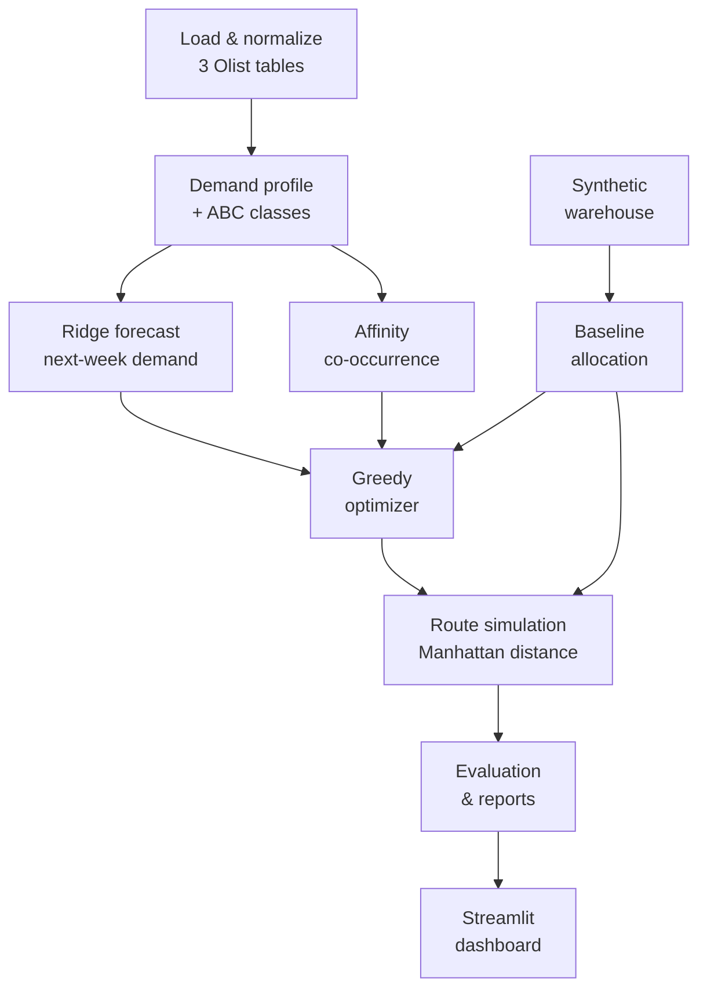

<div align="center">

# 🐍 SnakeCharmers

### Smart Warehouse Slotting & Optimization

*Forecast demand. Slot smarter. Walk less.*


[Quick start](#-quick-start) · [Data](#-input-data-kaggle--olist) · [How it works](#-how-it-works) · [Configuration](#%EF%B8%8F-configuration) · [Results](#-latest-results) · [Roadmap](#-future-ai-upgrade-plan)

</div>

---

## 📖 Overview

SnakeCharmers is a **reproducible research prototype** that uses historical Olist e-commerce orders to:

1. 📊 profile SKU demand,
2. 🔮 forecast next-week demand,
3. 🏭 allocate an active assortment to a **synthetic** warehouse,
4. 🧭 optimize slotting with a constraint-aware greedy heuristic,
5. 🚶 simulate picking routes, and
6. ⚖️ compare baseline vs. optimized layouts.

> [!IMPORTANT]
> This is a **simulation, not a deployment-ready warehouse safety system.** The source data is historical (2016–2018), has no current inventory snapshot, and provides no dependable hazard/handling classifications. Warehouse geometry and route distances are synthetic. **Unknown safety data must remain unverified.**

---

## 🚀 Quick start

> Windows PowerShell, run from the repository root.

```powershell
git checkout Magnus
git pull origin Magnus
.venv\Scripts\python.exe -m pip install -r requirements.txt
.venv\Scripts\python.exe -m pytest -q
.venv\Scripts\python.exe -m scripts.run_pipeline
.venv\Scripts\python.exe scripts\validate_saved_layouts.py
.venv\Scripts\python.exe -m streamlit run dashboard.py
```

The Streamlit command prints a local URL, so open it in a browser and stop the server with `Ctrl+C`.

<details>
<summary><b>Setting up from scratch</b></summary>

```powershell
py -m venv .venv
.venv\Scripts\python.exe -m pip install --upgrade pip
.venv\Scripts\python.exe -m pip install -r requirements.txt
```

</details>

---

## 📦 Input data: Kaggle / Olist

**Source:** [Olist Brazilian E-Commerce Public Dataset](https://www.kaggle.com/datasets/olistbr/brazilian-ecommerce) (Brazilian marketplace orders, 2016–2018). Raw data is **not** committed to this repository.

```powershell
.venv\Scripts\python.exe -m scripts.download_olist
.venv\Scripts\python.exe -m scripts.prepare_data
```

> [!NOTE]
> The download requires a Kaggle account, acceptance of the dataset terms, and Kaggle API credentials. The project loads **only 3 of the 9** original Olist CSVs.

### Raw columns used

| Olist CSV | Columns read | How they are used |
|---|---|---|
| `olist_orders_dataset.csv` | `order_id`, `order_purchase_timestamp`, `order_status` | Join key, demand timestamp, and demand-status filter. |
| `olist_order_items_dataset.csv` | `order_id`, `order_item_id`, `product_id`, `price`, `freight_value` | Order/SKU relationship; price and freight retained in normalized data. Each order-item row = one demand-line observation. |
| `olist_products_dataset.csv` | `product_id`, `product_category_name`, `product_weight_g`, `product_length_cm`, `product_height_cm`, `product_width_cm` | SKU ID, category, dimensions, weight (g → kg). Length is mapped to project depth. |

<details>
<summary><b>Files <u>not</u> read by the pipeline</b></summary>

`olist_customers_dataset.csv`, `olist_order_payments_dataset.csv`, `olist_order_reviews_dataset.csv`, `olist_sellers_dataset.csv`, `olist_geolocation_dataset.csv`, `product_category_name_translation.csv`.

Fields in these files must **not** be described as current model features. They may be considered in future only if they support a clearly defined warehouse objective and can be joined and validated correctly.

</details>

### Transformations & limitations

| Raw field | Project field |
|---|---|
| `order_id` | `Order_ID` |
| `product_id` | `SKU_ID` |
| `order_purchase_timestamp` | `Timestamp` |
| `order_status` | `Order_Status` |

- **Quantity:** Olist has no reliable item-quantity field, so `Quantity = 1.0` per recorded item line. Forecast demand therefore means **recorded order-item lines**, not verified units sold or in stock.
- **Demand scope:** controlled by `demand_statuses` (currently `["delivered"]`).
- **Fit checks:** `Volume_cm3 = width × height × depth`; rotation is checked against bin dimensions when enabled.
- **Unknown attributes:** `Hazard_Class` and `Handling_Type` are `UNSPECIFIED`; `Inventory_Units` is missing (no stock snapshot in the source).
- **Inventory fallback:** `representative_inventory_units = 1` is a **simulation assumption**, not an observed quantity. Validation still marks inventory checks `UNVERIFIED`.
- ⚠️ Never infer hazard class, safe handling, or storage compatibility from a product category name.

---

## 🧠 How it works

Two distinct components work together:

| # | Component | Type |
|---|---|---|
| 1 | **Demand forecast** (`src/ml_demand.py`) | Supervised **Ridge regression** |
| 2 | **Slotting optimizer** (`src/optimizer.py`) | Rule-based **greedy heuristic** (not a trained model) |

### Pipeline



1. Load and normalize the three required Olist tables.
2. Build demand profile and ABC demand classes.
3. Forecast next-week demand with Ridge.
4. Compute SKU co-occurrence affinity.
5. Generate synthetic warehouse locations.
6. Allocate the active assortment with a deterministic feasible baseline.
7. Reassign feasible slots using forecast priority, distance, affinity, and ergonomic heuristics.
8. Simulate nearest-next-SKU picking routes using Manhattan distance.
9. Compare route distance/time, coverage, utilization, and validation completeness.
10. Save reports and CSV outputs for the dashboard.

### 🔮 1. Demand forecast

| Setting / feature | Definition | Role |
|---|---|---|
| Estimator | scikit-learn `Ridge`, `alpha = 1.0` | Predicts next-week SKU demand. |
| Target | Weekly count of order-item lines per SKU, trained on `log1p` | One-step-ahead forecast. |
| `Lag_1` | Previous week's line count | Recent demand signal. |
| `Lag_4` | Line count four weeks earlier | Recent-history signal (not a full seasonal model). |
| `Rolling_4` | Mean of up to the previous four weeks (shifted, excludes target week) | Recent demand level. |
| `Historical_Mean` | Expanding mean of previous weeks (shifted, excludes target week) | Long-term SKU level. |
| `Week_Index` | Weeks since first observed week | Simple time trend. |
| `Category` | Normalized `product_category_name`, one-hot encoded | Product context. |

<details>
<summary><b>Preprocessing & training behavior</b></summary>

- Demand is filtered to configured `demand_statuses` and bucketed into weekly periods; missing SKU/week combinations are filled with zero.
- Training rows need non-missing `Lag_1`, `Lag_4`, `Rolling_4`, `Historical_Mean`. Training is **skipped if fewer than 20 rows** remain.
- Numeric features: median imputation → `StandardScaler`. `Category`: most-frequent imputation → `OneHotEncoder(handle_unknown="ignore")`.
- Predictions are transformed back with `expm1` and clipped to be non-negative.
- With no valid timestamps or too few rows, the model reports `trained = false` and predictions stay zero. Check the generated ML report for actual run status.

</details>

> [!WARNING]
> The model currently fits on the available history and forecasts next week. It does **not yet report a held-out, rolling-origin score**. This is required before claiming the model is accurate.

### 🧭 2. How the forecast drives slotting

- SKUs are processed in descending `Predicted_Next_Week_Demand` (SKU ID breaks ties), so high-demand SKUs get first pick of feasible locations.
- **Hard constraints:** dimensional fit, location volume/weight limits, shelf/rack loads, and configured incompatibility rules. Unknown hazard/handling data is reported as *unverified*, never as proof of safety.
- **Candidate score (minimized):**

  ```text
  distance_weight × depot_distance
    + ergonomic_weight × heavy_shelf_penalty
    − affinity_weight × affinity_proximity_bonus
  ```

- **Weights:** `distance = 1.0`, `affinity = 0.25`, `ergonomic = 0.1`.
- **Affinity:** from SKUs sharing an order. Pair strength = `log1p(Pair_Count) × log1p(Lift)`. Proximity uses Manhattan distance normalized by the maximum depot distance.
- **Ergonomics:** the optimizer uses a hard-coded 10 kg condition, while the validator uses the configured threshold. These should be unified in a future cleanup.
- **Baseline vs optimized:** the baseline is deterministic and historically demand-ranked; the optimized layout uses ML forecast priority. Both are evaluated on the same baseline-selected active assortment.
- This is a **one-pass greedy heuristic**; it does not prove global optimality.

---

## ⚙️ Configuration

Main run config: [`config/simulation_config.json`](config/simulation_config.json).

| Parameter | Value | What it controls / status |
|---|---|---|
| `demand_statuses` | `["delivered"]` | Order lines used for demand, forecasting, affinity, routing. |
| `max_active_skus` | `200` | Max assortment size allocated/evaluated. |
| `representative_inventory_units` | `1` | Simulation fallback when inventory is absent. |
| `allow_rotations` | `true` | Allow dimension permutations in fit checks. |
| `ergonomics.heavy_sku_weight_kg` | `10.0` | Heavy-SKU threshold used by validation. |
| `ergonomics.max_shelf_level_for_heavy_skus` | `2` | Max shelf level for heavy SKUs in validation. |
| `incompatibility_rules.category_hazard_pairs` | `[]` | Category/hazard rules (none supplied). |
| `incompatibility_rules.hazard_handling_pairs` | `[]` | Hazard/handling rules (none supplied). |
| `abc_thresholds` | A `0.80`, B `0.95` | Cumulative demand-share ABC cut-offs. |
| `walking_speed_m_per_min` | `75.0` | Assumed walking speed (not measured). |
| `pick_handling_seconds` | `12.0` | Assumed handling time per simulated order. |
| `objective_weights.distance` | `1.0` | Weight on depot distance. |
| `objective_weights.affinity` | `0.25` | Weight on affinity bonus. |
| `objective_weights.ergonomic` | `0.1` | Weight on shelf-level penalty. |

<details>
<summary><b>⚠️ Declared but currently unused / not wired in</b></summary>

| Parameter | Value | Status |
|---|---|---|
| `affinity_min_pair_count` | `2` | Not passed to `compute_affinity`; function default `1` is used. |
| `affinity_min_support` | `0.0` | Not passed to `compute_affinity`; function default `0.0` is used. |
| `objective_weights.waste` | `0.00001` | Not used by the greedy optimizer. |
| `random_seed` | `42` | Pipeline stages are deterministic and don't consume it. |
| `max_local_search_iterations` | `100` | Not used; optimizer is one greedy pass. |

Also: `max_orders = 500` is a default argument in `src/routing.py`, and the Ridge settings (`alpha`, imputation, scaling, encoding, 20-row minimum) are fixed in code rather than exposed in JSON.

</details>

<details>
<summary><b>🏭 Synthetic warehouse geometry</b> (<code>config/warehouse_config.json</code>)</summary>

| Property | Value |
|---|---|
| Aisles | 6 (two rack sides each) |
| Bays per rack / shelf levels | 5 / 4 |
| Aisle spacing / bay spacing | 3.0 m / 1.2 m |
| First aisle X / first bay Y | 3.0 m / 2.0 m |
| Default bin | 40 × 30 × 40 cm |
| Levels 1–2 bins | 100 × 60 × 60 cm |
| Weight capacity by level | 40 / 35 / 30 / 20 kg |
| Shelf / rack limit | 200 kg / 700 kg |
| Oversized slots | 4 dedicated, with own dimensions, capacities, coordinates |

All values are **synthetic assumptions** and must be replaced with measured site data for a real warehouse.

</details>

---

## 📈 Latest results

From the maintainer's latest recorded local run (see [HANDOVER.md](HANDOVER.md)): 500 simulated orders, 494 complete routes per strategy.

| Metric | Baseline | Optimized | Change |
|---|---:|---:|---:|
| Total route distance | 13,191.2 m | 11,591.6 m | **−1,599.6 m (≈ −12.13%)** |
| Estimated total time | 275.88 min | 254.55 min | **−21.33 min** |
| Active-assortment allocation | 200 / 200 | 200 / 200 | — |
| Confirmed violations | 0 | 0 | — |
| Unverified checks | 600 | 600 | — |

Tests: **25 passing** · Pipeline runtime: **≈ 92 s**

> [!CAUTION]
> These are **simulation outputs, not measured warehouse performance.** Always quote numbers from your own latest run (`reports/final_validation_report.md`), not older ones.

---

## 🛡️ Interpreting results safely

| Term | Meaning |
|---|---|
| **Active assortment coverage** | % of *selected* SKUs allocated, not coverage of the full catalog. |
| **Catalog-wide coverage** | Allocated rows ÷ full SKU profile; low when only a limited assortment is modeled. |
| **Whole-warehouse utilization** | Modeled SKU volume ÷ total generated warehouse capacity. |
| **Allocated-bin utilization** | Modeled SKU volume ÷ capacity of bins actually used. |
| **Confirmed violations** | Checks explicitly marked `VIOLATION`. |
| **Unverified checks** | Missing/unknown data. They are *not* violations, but also *not* proof of safety. |
| **Demand forecast** | Next-week recorded order-line counts from history, not a real-time inventory or replenishment system. |
| **Route distance/time** | Estimates from simplified synthetic geometry. |
| **Optimizer** | Greedy heuristic, not a globally optimal solver. |

---

## 🗂️ Project structure

```text
SnakeCharmers/
├── config/                  # simulation_config.json, warehouse_config.json
├── src/                     # core logic
│   ├── data_loader.py       #   load & normalize Olist tables
│   ├── demand_analysis.py   #   demand profile, ABC classes
│   ├── ml_demand.py         #   Ridge next-week forecast
│   ├── affinity_analysis.py #   SKU co-occurrence
│   ├── warehouse_generator.py
│   ├── baseline.py          #   deterministic baseline allocation
│   ├── optimizer.py         #   greedy slotting heuristic
│   ├── feasibility.py       #   hard constraints & validation
│   ├── routing.py           #   picking route simulation
│   └── evaluation.py        #   baseline vs optimized metrics
├── scripts/                 # download_olist, prepare_data, run_eda,
│                            # run_pipeline, validate_saved_layouts
├── tests/                   # pytest suite
├── data/{raw,processed}/    # Olist inputs / generated CSVs
├── reports/                 # audits, plots, validation reports
├── dashboard.py             # Streamlit dashboard
├── HANDOVER.md              # setup, checklist, known limitations
└── requirements.txt
```

### Generated reports

`data_foundation_audit.md` · `eda_report.md` · `ml_demand_report.md` · `optimization_report.md` · `unallocated_sku_diagnosis.md` · `final_validation_report.md`

Generated CSVs go to `data/processed/` (typically Git-ignored); reports go to `reports/`.

---

## 🔭 Future AI upgrade plan

A stronger model should only replace Ridge after a **reproducible evaluation proves it is better**.

1. **Trustworthy baseline:** add chronological rolling-origin backtests. Report MAE, RMSE, and WAPE (handle zero denominators explicitly), overall and by segment/category. Compare against naïve baselines (last week, moving average).
2. **Stronger tabular models:** benchmark HistGradientBoosting, LightGBM, or CatBoost against Ridge on identical splits/features. Don't assume a deep network is better.
3. **Features only when justified:** calendar/seasonality, richer lags, reliable price/promo signals, product attributes. **No future leakage.** Consider Olist's short, old history.
4. **Improve the optimizer separately:** benchmark local search, simulated annealing, or OR-Tools against the greedy result. Keep hard constraints separate from soft objectives; report runtime and quality.
5. **Fair acceptance gate:** keep Ridge + greedy as the baseline. Adopt a replacement only if time-based test performance and end-to-end slotting metrics improve consistently, runtime is acceptable, tests pass, and safety/inventory data gaps stay visible.

Document every future input by source field, transformation, missing-value treatment, and availability at prediction time. Don't add customer, review, payment, or geolocation fields just because they exist, and show first that they help without leakage.

---

## ✅ Continuous integration

GitHub Actions (`.github/workflows/tests.yml`) runs `pytest -q` on Python 3.15 for every push and pull request.

## 📚 More

See **[HANDOVER.md](HANDOVER.md)** for setup, the acceptance checklist, known limitations, and transfer notes.

<div align="center">

<sub>Built as a simulation research prototype. Have a qualified owner review safety requirements before any operational use.</sub>

</div>
