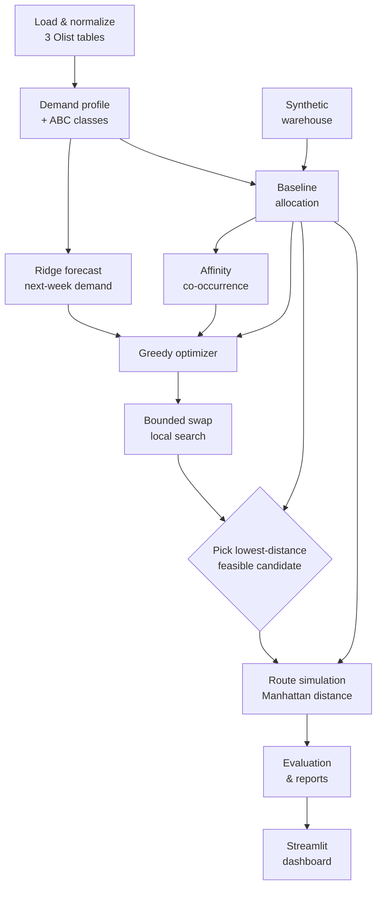
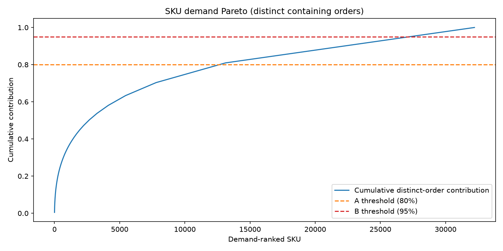
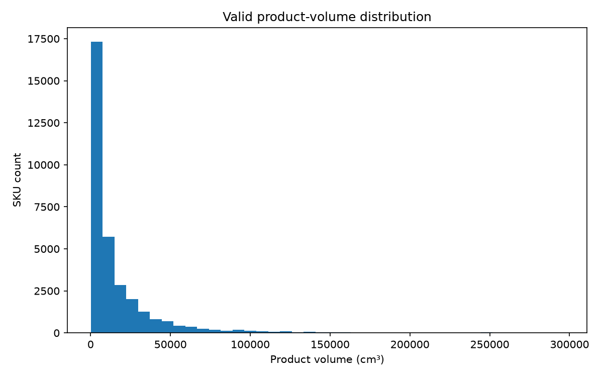
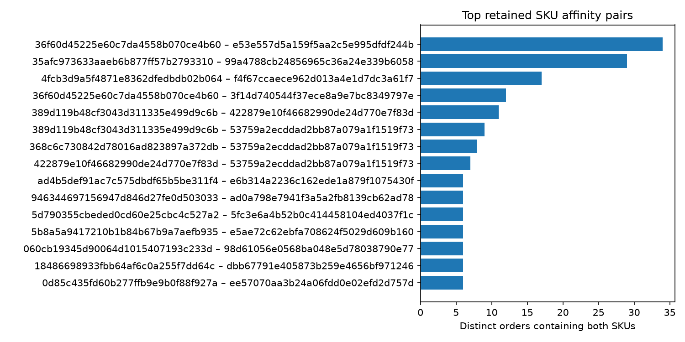

<div align="center">

# 🐍 SnakeCharmers

### Smart Warehouse Slotting & Optimization

*Forecast demand. Slot smarter. Walk less.*


[Overview](#-overview) · [Quick start](#-quick-start) · [Data](#-input-data-kaggle--olist) · [How it works](#-how-it-works) · [Configuration](#%EF%B8%8F-configuration) · [Results](#-latest-results) · [Roadmap](#-roadmap)

</div>

---

## 📖 Overview

SnakeCharmers is a **reproducible research prototype** that uses historical Olist e-commerce orders to decide *where each product should live in a warehouse* so pickers walk less.

| Step | What happens |
|:---:|---|
| 1 | 📊 Profile SKU demand and assign ABC classes |
| 2 | 🔮 Forecast next-week demand per SKU |
| 3 | 🏭 Allocate an active assortment to a **synthetic** warehouse |
| 4 | 🧭 Optimize slotting (constraint-aware greedy + bounded local search) |
| 5 | 🚶 Simulate picking routes |
| 6 | ⚖️ Compare baseline vs. optimized layouts and show them in a dashboard |

> [!IMPORTANT]
> This is a **simulation, not a deployment-ready warehouse safety system.** The source data is historical (2016–2018), has no current inventory snapshot, and provides no dependable hazard/handling classifications. Warehouse geometry and route distances are synthetic. **Unknown safety data must remain unverified.**

### At a glance

| | |
|---|---|
| **Demand forecast** | scikit-learn Ridge regression on weekly recorded order-line counts |
| **Default slotting optimizer** | Greedy heuristic + bounded feasible-swap local search |
| **MILP assortment selector** | Separate two-stage experimental module; not called by the default pipeline |
| **Routing** | Nearest-next-SKU, Manhattan distance |
| **Warehouse** | Synthetic: 6 aisles × 2 rack sides × 5 bays × 4 shelf levels, plus 4 oversized slots |
| **Active assortment** | Configured assortment cap; actual selected count depends on allocation and feasibility |
| **Interface** | Streamlit dashboard + CSV/Markdown reports |

---

## 🚀 Quick start

> Windows PowerShell, run from the repository root.

```powershell
git checkout main
git pull origin main
.venv\Scripts\python.exe -m pip install -r requirements.txt
.venv\Scripts\python.exe -m pytest -q
.venv\Scripts\python.exe -m scripts.run_pipeline
.venv\Scripts\python.exe scripts\validate_saved_layouts.py
.venv\Scripts\python.exe -m streamlit run dashboard.py
```

Streamlit prints a local URL; open it in a browser and stop the server with `Ctrl+C`.

<details>
<summary><b>Setting up from scratch</b></summary>

```powershell
py -m venv .venv
.venv\Scripts\python.exe -m pip install --upgrade pip
.venv\Scripts\python.exe -m pip install -r requirements.txt
```

</details>

### Command cheat sheet

| Goal | Command |
|---|---|
| Download raw Olist data | `python -m scripts.download_olist` |
| Normalize raw data | `python -m scripts.prepare_data` |
| Exploratory analysis | `python -m scripts.run_eda` |
| Run the full pipeline | `python -m scripts.run_pipeline` |
| Re-validate saved layouts (no regeneration) | `python scripts/validate_saved_layouts.py` |
| Run tests | `python -m pytest -q` |
| Launch dashboard | `python -m streamlit run dashboard.py` |

> [!TIP]
> The dashboard reads generated files from `data/processed/`. The current `Magnus` dashboard still needs runtime fixes noted below; rerunning the pipeline alone may not resolve dashboard errors.

---

## 📦 Input data: Kaggle / Olist

**Source:** [Olist Brazilian E-Commerce Public Dataset](https://www.kaggle.com/datasets/olistbr/brazilian-ecommerce) (Brazilian marketplace orders, 2016–2018). Raw data is **not** committed to this repository.

```powershell
.venv\Scripts\python.exe -m scripts.download_olist
.venv\Scripts\python.exe -m scripts.prepare_data
```

> [!NOTE]
> The download requires a Kaggle account, acceptance of the dataset terms, and Kaggle API credentials (never commit `kaggle.json`). The project loads **only 3 of the 9** original Olist CSVs.

### Raw columns used

| Olist CSV | Columns read | How they are used |
|---|---|---|
| `olist_orders_dataset.csv` | `order_id`, `order_purchase_timestamp`, `order_status` | Join key, demand timestamp, demand-status filter |
| `olist_order_items_dataset.csv` | `order_id`, `order_item_id`, `product_id`, `price`, `freight_value` | Order/SKU relationship; price and freight kept in normalized data. Each order-item row = one demand-line observation |
| `olist_products_dataset.csv` | `product_id`, `product_category_name`, `product_weight_g`, `product_length_cm`, `product_height_cm`, `product_width_cm` | SKU ID, category, dimensions, weight (g → kg). Length is mapped to depth |

<details>
<summary><b>Files <u>not</u> read by the pipeline</b></summary>

`olist_customers_dataset.csv`, `olist_order_payments_dataset.csv`, `olist_order_reviews_dataset.csv`, `olist_sellers_dataset.csv`, `olist_geolocation_dataset.csv`, `product_category_name_translation.csv`.

Fields in these files must **not** be described as current model features. They may be considered in future only if they support a clearly defined warehouse objective and can be joined and validated correctly.

</details>

### Transformations & limitations

| Raw field | Project field |
|---|---|
| `order_id` | `Order_ID` |
| `product_id` | `SKU_ID` |
| `order_purchase_timestamp` | `Timestamp` |
| `order_status` | `Order_Status` |

- **Quantity:** Olist has no reliable item-quantity field, so `Quantity = 1.0` per recorded item line. Forecast demand therefore means **recorded order-item lines**, not verified units sold or in stock.
- **Demand scope:** controlled by `demand_statuses` (currently `["delivered"]`).
- **Fit checks:** `Volume_cm3 = width × height × depth`; rotation is checked against bin dimensions when enabled.
- **Unknown attributes:** `Hazard_Class` and `Handling_Type` are `UNSPECIFIED`; `Inventory_Units` is missing (no stock snapshot in the source).
- **Inventory fallback:** `representative_inventory_units = 1` is a **simulation assumption**, not an observed quantity. Validation still marks inventory checks `UNVERIFIED`.
- ⚠️ Never infer hazard class, safe handling, or storage compatibility from a product category name.

---

## 🧠 How it works

The codebase contains three different roles. **Ridge forecasting and heuristic slotting are wired into the default pipeline; the MILP assortment selector is a separate experiment and is not currently called by `scripts/run_pipeline.py`.** MILP does not replace Ridge: they solve different problems.

| # | Component | Module | Type / status |
|:---:|---|---|---|
| 1 | **Demand forecast** | `src/ml_demand.py` | Supervised **Ridge regression**; used by the default pipeline |
| 2 | **Default slotting optimizer** | `src/optimizer.py` | Greedy heuristic + bounded feasible-swap local search; used by the default pipeline |
| 3 | **MILP assortment selector** | `src/milp_assortment.py` | Two-stage mixed-integer linear program (SciPy `milp`); separate experiment, not wired into the default pipeline |

### Pipeline



1. Load and normalize the three required Olist tables.
2. Build the demand profile and ABC demand classes.
3. Forecast next-week demand with Ridge.
4. Generate the synthetic warehouse locations.
5. Allocate the active assortment with a deterministic, feasible **baseline** (independent of ML).
6. Compute SKU co-occurrence affinity on that same assortment.
7. Reassign feasible slots using forecast priority, distance, affinity, and ergonomic heuristics (**greedy**).
8. Run a bounded, deterministic **swap local search** on the greedy layout (**refined**).
9. Validate `baseline`, `greedy`, and `refined`; keep only candidates with 0 confirmed violations and select the one with the lowest simulated route distance.
10. Simulate nearest-next-SKU picking routes (Manhattan distance) for baseline and selected layout.
11. Compare route distance/time, coverage, utilization, and validation completeness.
12. Save reports and CSVs for the dashboard.

> [!NOTE]
> Because the selection gate can pick the baseline, a run is allowed to show **no improvement**. Check `reports/optimization_report.md` (`selected_layout`, `candidate_layouts`) to see which layout won in your run.

### MILP assortment-selection experiment

`src/milp_assortment.py` uses SciPy's mixed-integer linear programming solver in two stages. It first maximizes the number of training orders whose complete SKU sets fit within the selected assortment cap; while retaining that optimum, it then maximizes the number of distinct training orders represented by at least one selected SKU. It filters to products with usable physical metadata and at least one dimensionally fitting location, and supports a candidate-pool limit and solver time limit.

**Integration status:** `scripts/run_pipeline.py` does not import or call this module in the current `Magnus` snapshot. The default pipeline instead uses `select_feasible_candidates` / `select_order_coverage_candidates` from `src/baseline.py` and then runs heuristic slotting/refinement. The MILP module has tests, but its existence does not mean the end-to-end pipeline is using MILP. To make MILP the active selector, the pipeline must call it, evaluate its result under the same constraints, and report solver status/optimality and holdout metrics.

> [!WARNING]
> **Current branch verification note:** the current `Magnus` snapshot has a pipeline issue in `scripts/run_pipeline.py`: a refinement block references `greedy` outside the scope where that variable is defined. Treat the full pipeline as unverified until this is corrected and rerun.

### 🔮 1. Demand forecast

| Setting / feature | Definition | Role |
|---|---|---|
| Estimator | scikit-learn `Ridge`, `alpha = 1.0` | Predicts next-week SKU demand |
| Target | Weekly count of order-item lines per SKU, trained on `log1p` | One-step-ahead forecast |
| `Lag_1` | Previous week's line count | Recent demand signal |
| `Lag_4` | Line count four weeks earlier | Recent-history signal (not a full seasonal model) |
| `Rolling_4` | Mean of up to the previous four weeks (shifted, excludes target week) | Recent demand level |
| `Historical_Mean` | Expanding mean of previous weeks (shifted, excludes target week) | Long-term SKU level |
| `Week_Index` | Weeks since first observed week | Simple time trend |
| `Category` | Normalized `product_category_name`, one-hot encoded | Product context |

<details>
<summary><b>Preprocessing & training behavior</b></summary>

- Demand is filtered to configured `demand_statuses` and bucketed into weekly periods; missing SKU/week combinations are filled with zero.
- Training rows need non-missing `Lag_1`, `Lag_4`, `Rolling_4`, `Historical_Mean`. Training is **skipped if fewer than 20 rows** remain.
- Numeric features: median imputation → `StandardScaler`. `Category`: most-frequent imputation → `OneHotEncoder(handle_unknown="ignore")`.
- Predictions are transformed back with `expm1` and clipped to be non-negative.
- With no valid timestamps or too few rows, the model reports `trained = false` and predictions stay zero. Check the generated ML report for actual run status.

</details>

> [!WARNING]
> The model currently fits on the available history and forecasts next week. It does **not yet report a held-out, rolling-origin score**. This is required before claiming the model is accurate.

### 🧭 2. How the forecast drives slotting

- SKUs are processed in descending `Predicted_Next_Week_Demand` (SKU ID breaks ties), so high-demand SKUs get first pick of feasible locations.
- **Hard constraints:** dimensional fit, location volume/weight limits, shelf/rack loads, heavy-SKU shelf height, and configured incompatibility rules. Unknown hazard/handling data is reported as *unverified*, never as proof of safety.
- **Candidate score (minimized):**

  ```text
  distance_weight × depot_distance
    + ergonomic_weight × heavy_shelf_penalty
    − affinity_weight × affinity_proximity_bonus
  ```

- **Weights:** `distance = 1.0`, `affinity = 0.25`, `ergonomic = 0.1`.
- **Affinity:** from SKUs sharing an order. Pair strength = `log1p(Pair_Count) × log1p(Lift)`. Proximity uses Manhattan distance normalized by the maximum depot distance.
- **Local search:** up to `max_local_search_iterations` (100) feasible location swaps, accepted only when simulated route distance drops; one pass.
- **Baseline vs optimized:** the baseline is deterministic and historically demand-ranked; the optimized layout uses ML forecast priority. Both are evaluated on the same baseline-selected active assortment.
- This is a heuristic and **does not prove global optimality**.
- **Known inconsistency:** the optimizer uses a hard-coded 10 kg heavy-SKU condition, while the validator uses the configured threshold. These should be unified.

### 🛡️ 3. Validation rules

`src/feasibility.py` provides one shared feasibility predicate used by the baseline, the optimizer, and the saved-layout validator:

| Category | Checks |
|---|---|
| References | SKU/location references exist; assignment and location uniqueness |
| Geometry | Dimension orientation and boundary fit; modeled bin volume |
| Loads | Location, shelf, and rack load limits (aggregate loads use the inventory fallback) |
| Ergonomics | Heavy SKUs only on allowed shelf levels |
| Compatibility | Configured *known* incompatibilities only (none are inferred) |
| Data quality | Invalid physical inputs; unverified inventory / hazard / handling inputs |

Each check ends as `OK`, `VIOLATION`, or `UNVERIFIED`. See [Interpreting results safely](#%EF%B8%8F-interpreting-results-safely).

---

## ⚙️ Configuration

Main run config: [`config/simulation_config.json`](config/simulation_config.json).

| Parameter | Value | What it controls |
|---|---|---|
| `demand_statuses` | `["delivered"]` | Order lines used for demand, forecasting, affinity, routing |
| `max_active_skus` | `500` | Configured cap; the actual selected/allocated count can be lower |
| `representative_inventory_units` | `1` | Simulation fallback when inventory is absent |
| `allow_rotations` | `true` | Allow dimension permutations in fit checks |
| `ergonomics.heavy_sku_weight_kg` | `10.0` | Heavy-SKU threshold used by validation |
| `ergonomics.max_shelf_level_for_heavy_skus` | `2` | Max shelf level for heavy SKUs in validation |
| `incompatibility_rules.category_hazard_pairs` | `[]` | Category/hazard rules (none supplied) |
| `incompatibility_rules.hazard_handling_pairs` | `[]` | Hazard/handling rules (none supplied) |
| `abc_thresholds` | A `0.80`, B `0.95` | Cumulative demand-share ABC cut-offs |
| `walking_speed_m_per_min` | `75.0` | Assumed walking speed (not measured) |
| `pick_handling_seconds` | `12.0` | Assumed handling time per simulated order |
| `objective_weights.distance` | `1.0` | Weight on depot distance |
| `objective_weights.affinity` | `0.25` | Weight on affinity bonus |
| `objective_weights.ergonomic` | `0.1` | Weight on shelf-level penalty |
| `max_local_search_iterations` | `100` | Max swap attempts in the local-search refinement |

<details>
<summary><b>⚠️ Declared but not wired into the main pipeline</b></summary>

| Parameter | Value | Status |
|---|---|---|
| `affinity_min_pair_count` | `2` | Used by `scripts/run_eda.py`, but **not** passed to `compute_affinity` in `run_pipeline.py` (function default `1` applies) |
| `affinity_min_support` | `0.0` | Same as above (function default `0.0` applies) |
| `objective_weights.waste` | `0.00001` | Not used by the optimizer |
| `random_seed` | `42` | Pipeline stages are deterministic and don't consume it |

Also: `max_orders = 500` is hard-coded in `src/routing.py` and the pipeline, and the Ridge settings (`alpha`, imputation, scaling, encoding, 20-row minimum) are fixed in code rather than exposed in JSON.

</details>

<details>
<summary><b>🏭 Synthetic warehouse geometry</b> (<code>config/warehouse_config.json</code>)</summary>

| Property | Value |
|---|---|
| Aisles | 6 (two rack sides each), grouped into zones A (1–2), B (3–4), C (5–6) |
| Bays per rack / shelf levels | 5 / 4 |
| Aisle spacing / bay spacing | 3.0 m / 1.2 m |
| First aisle X / first bay Y | 3.0 m / 2.0 m |
| Dispatch depot | (0, 0, 0) |
| Default bin | 40 × 30 × 40 cm (W × H × D) |
| Levels 1–2 bins | 100 × 60 × 60 cm |
| Weight capacity by level (1 → 4) | 40 / 35 / 30 / 20 kg |
| Shelf / rack limit | 200 kg / 700 kg |
| Oversized slots | 4 dedicated (3 × 70×20×70 cm, 1 × 110×20×20 cm), 40 kg each |

All values are **synthetic assumptions** and must be replaced with measured site data for a real warehouse.

</details>

---

## 📈 Latest results

Results in this repository may come from different code versions or data snapshots, so this README intentionally does **not** publish fixed performance numbers. Re-run the pipeline and inspect `data/processed/evaluation_comparison.csv`, `reports/final_validation_report.md`, and `reports/optimization_report.md` before quoting metrics. Record the run date, selected layout, route sample, and assumptions alongside any reported result.

> [!CAUTION]
> These are **simulation outputs, not measured warehouse performance.** Confirm that reports and CSVs were generated by the same current run; committed generated files may be stale.

### Generated plots

| Demand concentration | Product volume | Affinity pairs |
|:---:|:---:|:---:|
|  |  |  |

---

## 🛡️ Interpreting results safely

| Term | Meaning |
|---|---|
| **Active assortment coverage** | % of *selected* SKUs allocated, not coverage of the full catalog |
| **Catalog-wide coverage** | Allocated rows ÷ full SKU profile; low when only a limited assortment is modeled |
| **Whole-warehouse utilization** | Modeled SKU volume ÷ total generated warehouse capacity |
| **Allocated-bin utilization** | Modeled SKU volume ÷ capacity of bins actually used |
| **Confirmed violations** | Checks explicitly marked `VIOLATION` |
| **Unverified checks** | Missing/unknown data. They are *not* violations, but also *not* proof of safety |
| **Demand forecast** | Next-week recorded order-line counts from history, not a real-time inventory or replenishment system |
| **Route distance/time** | Estimates from simplified synthetic geometry |
| **Default slotting optimizer** | Greedy/local-search heuristic; it does not prove global optimality |
| **MILP assortment experiment** | Exact mixed-integer model for its formulated selection objective when the solver proves optimality; currently not wired into the default pipeline |

### Known limitations

1. **Synthetic warehouse:** rack layout, dimensions, capacities, and coordinates are configuration-driven, not a surveyed facility.
2. **Inventory is unknown:** Olist has no stock snapshot; representative-stock assumptions must be labeled.
3. **Hazard and handling data are unknown:** never infer them from category names.
4. **Demand proxy:** order-item lines are not a measured inventory quantity.
5. **Default slotting optimization:** heuristic and not globally optimal. The separate MILP assortment experiment optimizes a different selection objective and is not currently used by the default pipeline.
6. **Estimated travel:** simulated, not measured.
7. **Utilization:** low modeled utilization may reflect the representative-stock assumption and assortment scope. Don't tune warehouse size or objectives just to improve the percentage.

For operational use you would need a real warehouse map and capacity ratings, current stock counts, product hazard/handling metadata, and a validated walkable route graph, plus review by a qualified safety owner.

---

## 🗂️ Project structure

```text
SnakeCharmers/
├── config/                   # simulation_config.json, warehouse_config.json
├── src/                      # core logic
│   ├── data_loader.py        #   load & normalize Olist tables
│   ├── demand_analysis.py    #   demand profile, ABC classes
│   ├── ml_demand.py          #   Ridge next-week forecast
│   ├── milp_assortment.py    #   experimental MILP assortment selector (not pipeline-wired)
│   ├── affinity_analysis.py  #   SKU co-occurrence
│   ├── warehouse_generator.py#   synthetic warehouse locations
│   ├── baseline.py           #   deterministic baseline allocation
│   ├── optimizer.py          #   greedy slotting + swap local search
│   ├── feasibility.py        #   hard constraints & validation
│   ├── routing.py            #   picking route simulation
│   └── evaluation.py         #   baseline vs optimized metrics
├── scripts/                  # download_olist, prepare_data, run_eda,
│                             # run_pipeline, validate_saved_layouts
├── tests/                    # pytest suite (engine, EDA, ML demand, optimizer)
├── data/{raw,processed}/     # Olist inputs / generated CSVs
├── reports/                  # audits, plots, validation reports
├── dashboard.py              # Streamlit dashboard
├── HANDOVER.md               # setup, checklist, known limitations
└── requirements.txt
```

### Generated outputs

| Location | Contents |
|---|---|
| `data/processed/` | Orders, SKU master, demand profile, allocations, routes, validation, `evaluation_comparison.csv` (typically Git-ignored) |
| `reports/` | `data_foundation_audit.md`, `eda_report.md`, `ml_demand_report.md`, `optimization_report.md`, `unallocated_sku_diagnosis.md`, `final_validation_report.md`, `correctness_hardening_report.md`, plots, evidence CSVs |

### 📊 Dashboard

The Streamlit dashboard (`dashboard.py`) is intended to show generated evaluation results, allocation samples, validation status, and affinity information. The current `Magnus` version is **not yet verified at runtime**: it references an undefined `comparison` variable and uses a DataFrame in a boolean expression. Fix these issues and test it against freshly generated outputs before relying on the dashboard.

---

## 🔭 Roadmap

Forecasting and assortment optimization are separate tasks: MILP is not a replacement for Ridge. Ridge forecasts demand; a selection optimizer decides which SKUs to include under a cap. Before changing either component, integrate and evaluate it on a reproducible end-to-end comparison.

- [ ] **Forecast evaluation:** chronological rolling-origin backtests with MAE, RMSE, WAPE (explicit zero-denominator handling), overall and by segment/category; compare against naïve baselines (last week, moving average)
- [ ] **Forecast alternatives:** benchmark HistGradientBoosting, LightGBM, or CatBoost against Ridge on identical splits/features
- [ ] **MILP integration:** wire `src/milp_assortment.py` into the pipeline if desired, then compare against demand-ranked and order-coverage-first selection on the same training/holdout split, SKU cap, physical constraints, runtime, solver status, and test-order coverage
- [ ] **Features only when justified:** calendar/seasonality, richer lags, reliable price/promo signals, product attributes, with **no future leakage**
- [ ] **Optimizer upgrades:** benchmark simulated annealing or OR-Tools against the current heuristic; keep hard constraints separate from soft objectives and report runtime and quality
- [ ] **Config cleanup:** wire or remove unused parameters; unify the heavy-SKU threshold between optimizer and validator
- [ ] **Fair acceptance gate:** adopt a replacement only if time-based test performance and end-to-end slotting metrics improve consistently, runtime is acceptable, tests pass, and safety/inventory data gaps stay visible

Document every future input by source field, transformation, missing-value treatment, and availability at prediction time. Don't add customer, review, payment, or geolocation fields just because they exist.

---

## ✅ Continuous integration

GitHub Actions (`.github/workflows/tests.yml`) is configured to run the test suite on Python 3.15. A passing test suite does not by itself verify the full pipeline or dashboard end to end.

## 🤝 Contributing & handover

1. Branch from `Magnus`, keep changes small and tested.
2. Run `pytest -q` and the pipeline before opening a PR.
3. Don't commit raw data, generated outputs, or Kaggle credentials.
4. Copy any quoted result from your latest local run.

See **[HANDOVER.md](HANDOVER.md)** for the acceptance checklist, metric definitions, and transfer notes.

<div align="center">

<sub>Built as a simulation research prototype. Have a qualified owner review safety requirements before any operational use.</sub>

</div>
